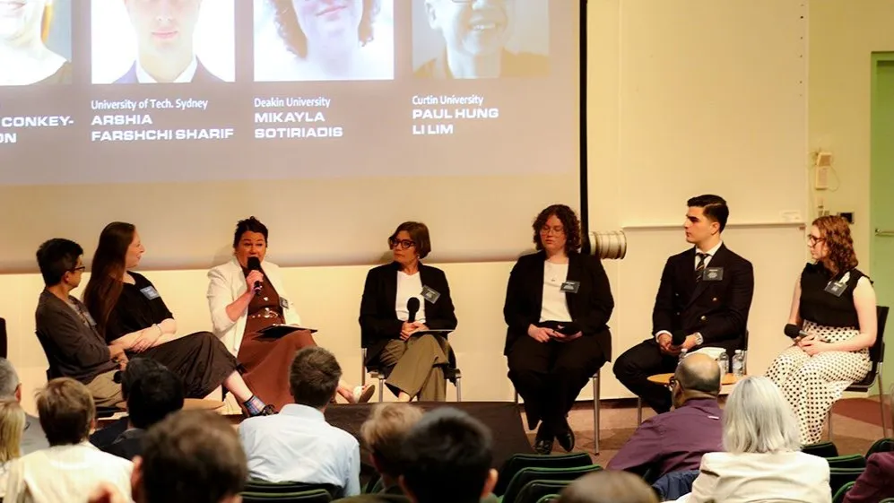
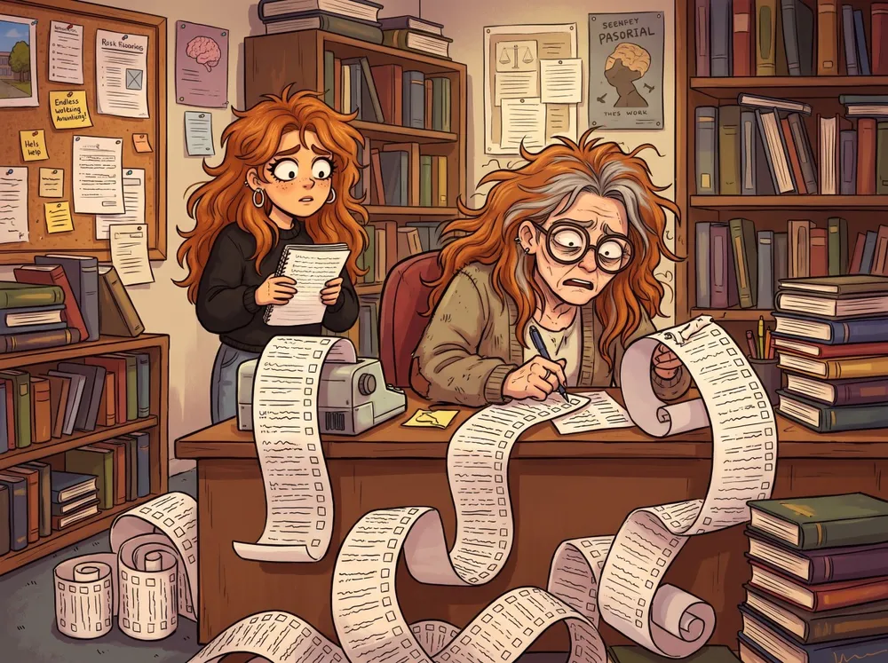
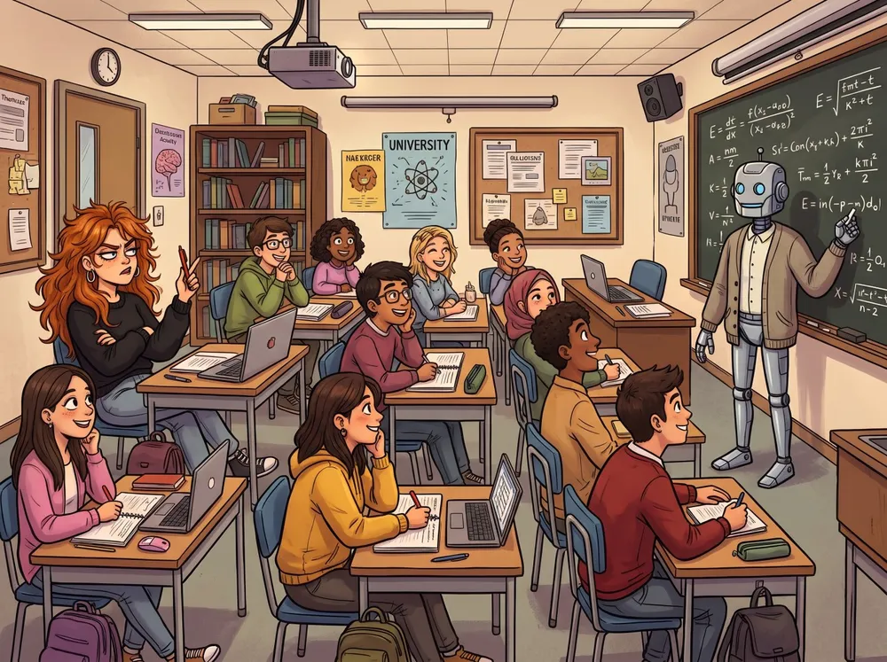
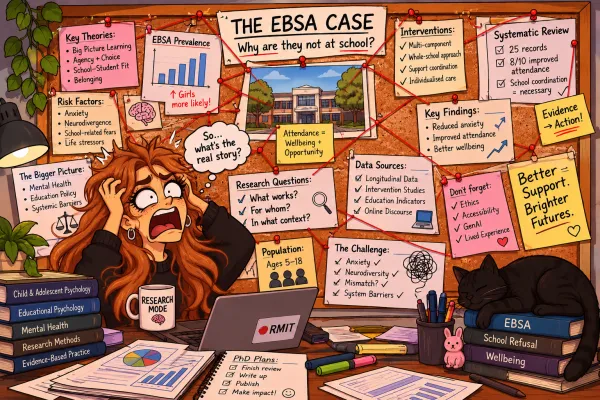
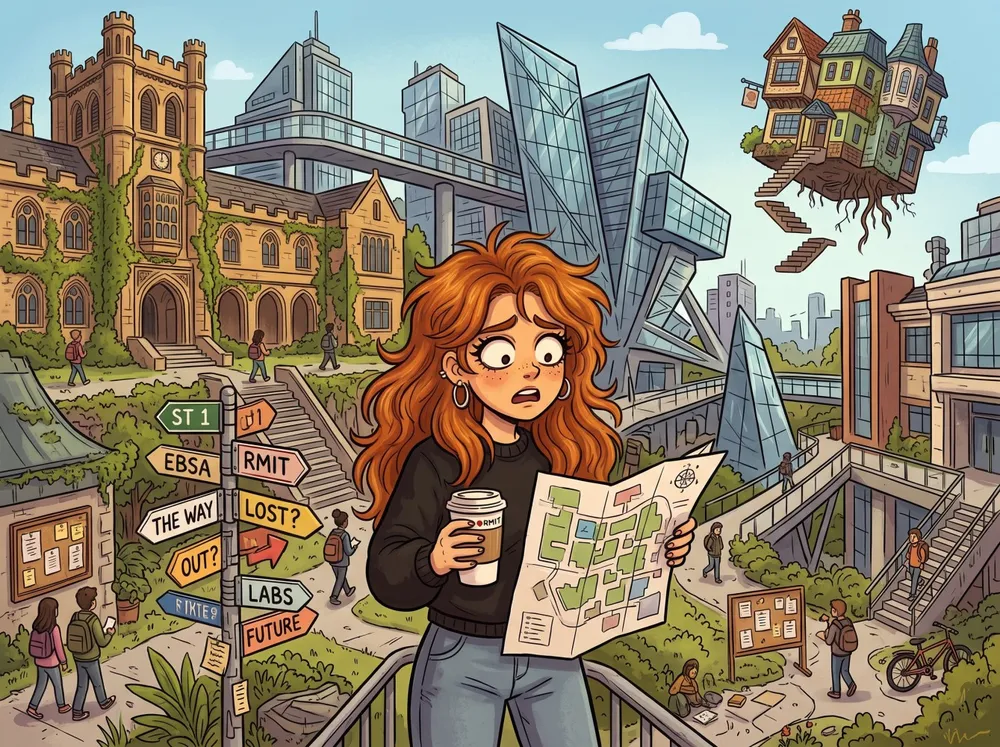
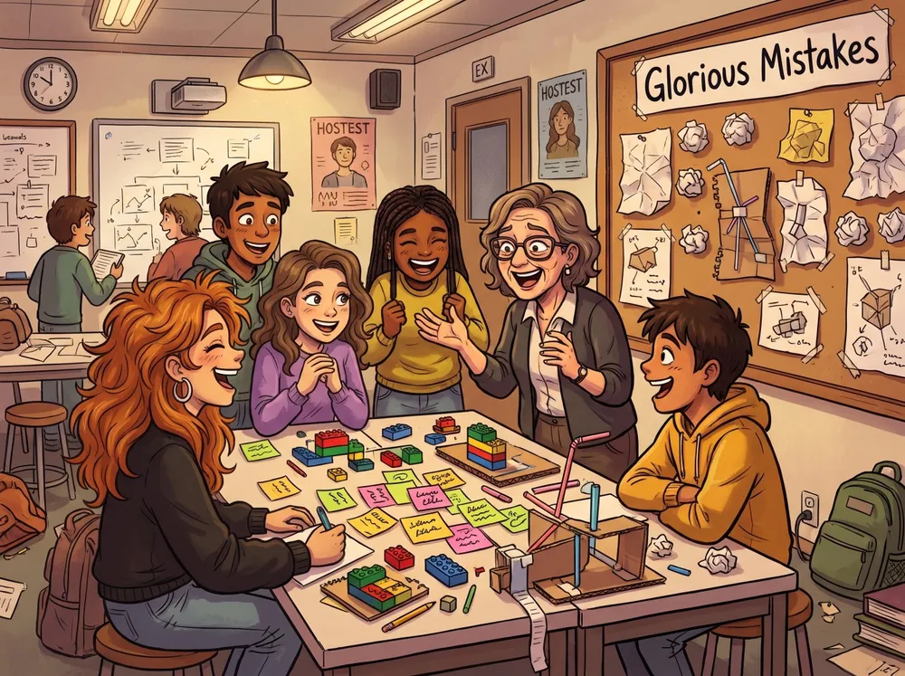
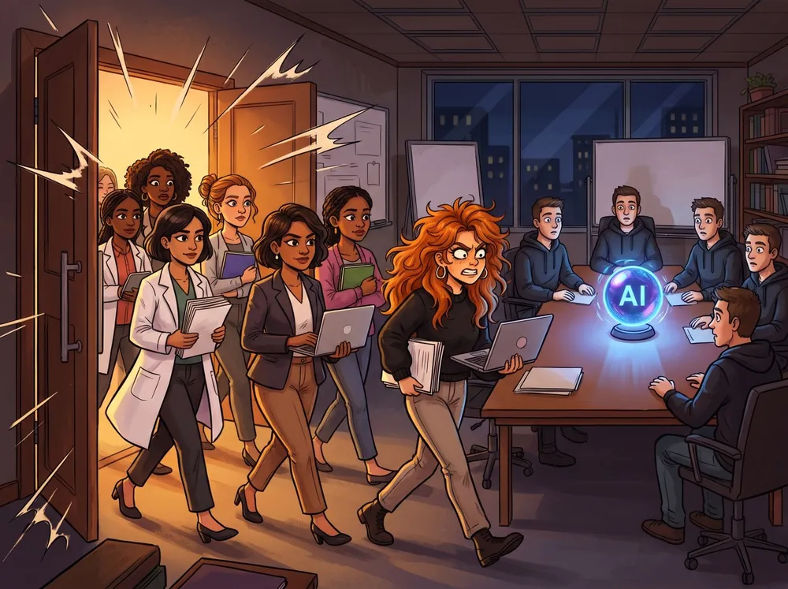

```{=html}
<style>#title-block-header { display: none !important; }</style>
<div class="page-header">
  <h1>AI, prove your worth: reflections from a benevolent adversary</h1>
</div>
<p class="post-meta-line">21 November 2026 &nbsp;·&nbsp; <span class="post-categories">AI &nbsp;·&nbsp; Higher education</span></p>
<hr class="post-rule">
<figure class="post-figure post-cover">
  
</figure>
```

### The stubborn art of being human (the ATN's symposium on AI, students and the future of higher ed) was one of the most fun days I've had in academia.

There was so much levity and self-awareness in the room, from students and academics alike, and nobody pretended to have it all figured out. Mohammad Chowdhury's keynote put words to so many ideas that have been messily bouncing around my head, and the mock trial had me cackling (academics [plus cyborg Simon Buckingham Shum] arguing over whether they could be replaced by AI without anyone noticing).

```{=html}
<figure class="post-figure">
  
  <figcaption>"Sorry, I'm too busy to chat about your thesis right now - but worry not - I'll be ticking off and finalising your AI feedback soon!"</figcaption>
</figure>
```

On the student panel, I shamefully admitted my relationship with AI... I treat it like the confident, well-prepared high school substitute teacher (i.e., clearly asking for my defiance). I'm in the back row wondering just where you got the nerve to come in talking like you're some kind of professional, or thinking you can make me do anything, at all, whatsoever. Then I poke holes until it either breaks or earns my respect (in return, it gets to be my Reviewer 2, so it's not just me doing the bullying).

```{=html}
<figure class="post-figure">
  
  <figcaption>"Well, ackshully..."</figcaption>
</figure>
```

I also shared that a significant aspect of using AI well is knowing when to walk away....

> If you can't make sense of what AI is giving you, it can't "get" the concept for you. You need to spend some time reading, adding to the murder board, and/or crying on the floor surrounded in papers.

```{=html}
<figure class="post-figure">
  
  <figcaption>"Nothing makes sense anymore! And I'm the problem!"</figcaption>
</figure>
```

We come to university for the wisdom of academics. For some students, particularly online students, feedback is one of the few touchpoints they have with staff (especially if lectures are pre-recorded or they can't make it to tutes). Take that away and they might not be getting any human contact at all. Chatting with Bert Verhoeven afterwards, we agreed the conversation often slid into "AI vs. human" when the more useful questions sit in "AI + human".

I suggested poor AI use could be a sign a student is struggling... be it with time, life outside uni, understanding the content, or the purpose of the learning outcomes. I think [RMIT's 2027 ATEC Compact](https://www.atec.gov.au/publications/royal-melbourne-institute-technology-compact-2027) has scope to address this with its planned pilot of ungraded first-semester assessment for new students, and I hope to see some training on critical use of AI tools during this period.

### But what's tricky is that some people will always be at uni for the 'piece of paper', or because it was just the next step after school.

Turning students into learners means teaching critical thinking (not rubric adherence). The employers on the industry panel said a degree isn't necessarily what they're looking for anymore (though they spoke fondly of the practical and soft skills it brings). It left me wondering what uni is actually responsible for... connection, wellbeing, a social life, learning, a role, a job? All of them? None?

```{=html}
<figure class="post-figure">
  
  <figcaption>It's very hard to find your way when you don't know where you're going and the signs aren't consistent.</figcaption>
</figure>
```

The idea of play kept coming up too: excellence only happens when people feel safe enough to play and make mistakes (sounds a lot like belonging to me)! I didn't get a chance to mention it on the day, but RMIT's 2027 ATEC compact names belonging in its vision, then frames it mostly through support services and inclusion policies. Though clearly important, there's very little about the human side (peers, teaching staff, actual connection), no measure of it, and no mention of online students at all. For a university of over 100 non-contiguous buildings, belonging needs to be built in on purpose.

```{=html}
<figure class="post-figure">
  
  <figcaption>If we got everything right all the time, what would be the point in studying at all? I'd be a rocket scientist for a laugh if it were all that easy.</figcaption>
</figure>
```

> I started university at 29 because that's when I felt ready to learn. You can't force that in someone, but you can certainly inspire it. I hope this is part of our plan.

Aaaand... tech companies (ugh). Private interests are being built into academic systems at a time when journals are struggling with retractions and peer review is beyond broken. Given Meta and Google were found liable this year over a young woman's social media addiction, we know that accountability is possible. Universities must also push for this. It would go a long way towards easing the (very reasonable) concerns about data safety, equity, sustainability and ownership. Belinda Tynan's closing wrap had me ready to stand on my chair: a call to get the "tech sisters" in the room to break up the tech bro boys club. Hell yes.

```{=html}
<figure class="post-figure">
  
  <figcaption>What's good, tech bros? We're here, and we're hungry (for your soulless vessels).</figcaption>
</figure>
```

A huge thanks to my fellow student panellists Kate Dixon, Mikayla Sotiriadis, Paul Hung Li Lim, Elsie Leask and Arshia Farshchi Sharif MRSN, and our moderator Amanda Mooney, all the other panellists, and the Australian Technology Network of Universities (ATN Universities) crew.

---

*Note. All images were created with AI image generation tools (based on my concept and creative direction). I apologise wholeheartedly for the inherent irony.*

*Originally published on [LinkedIn](https://www.linkedin.com/pulse/ai-prove-your-worth-reflections-from-benevolent-conkey-morrison-iupvc) on 21 November 2026.*
